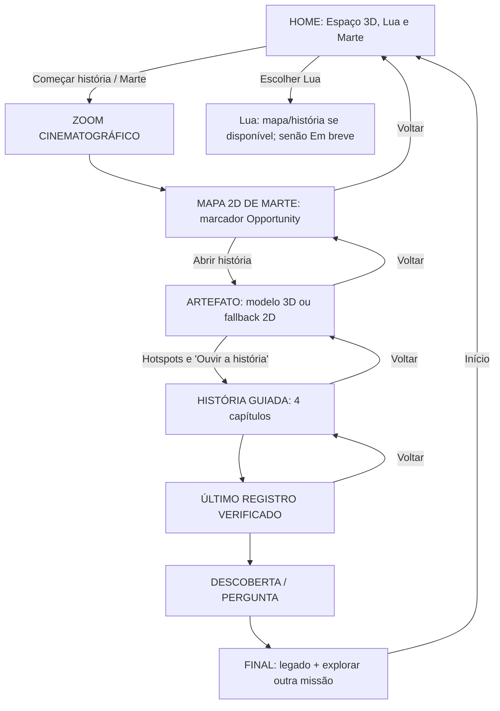

# CODEX — IMPLEMENTAR O PROJETO “AFTER THE SIGNAL”

> **Leia este arquivo inteiro antes de codar.** Este documento é uma especificação de implementação pronta para passar ao Codex. Não é uma solicitação de planejamento adicional: **implemente o aplicativo**, após o início oficial do hackathon, na medida das permissões do ambiente. Entregue a melhor fatia vertical funcionando, mesmo que alguns assets precisem de fallbacks honestos.
>
> **Regra do evento:** segundo orientação pública dos organizadores, iniciar trabalho no projeto antes de **14 de novembro de 2026** pode comprometer a elegibilidade. Respeite o horário de início oficial e as regras do seu evento antes de executar este prompt.

## 0. O produto, em uma frase

**After the Signal — O que ficou depois do silêncio** é um museu espacial interativo para crianças (aproximadamente 8–13 anos) sobre máquinas reais deixadas na Lua e em Marte. O visitante escolhe um mundo, viaja visualmente até ele, encontra um equipamento, explora suas partes e ouve uma história curta, emocionante e cientificamente correta. No fim, aprende o legado da missão.

**Não** faça um simulador do Sistema Solar, dashboard científico, catálogo enciclopédico, jogo com controles complexos ou landing page sem navegação funcional.

O foco é: **uma criança consegue usar sem ajuda; emoção leva à curiosidade; curiosidade leva à ciência.**

**História principal completa e obrigatória:** rover Opportunity (Marte).  
**Segunda história somente após a primeira ficar pronta:** Apollo 11 / estágio de descida do módulo Eagle (Lua).  
Os outros planetas devem estar ausentes ou com indicação honesta “Em breve”.

---

## 1. Jornada e fluxograma de telas



**Máquina de estados explícita:**

```ts
type Screen = 'home' | 'approach' | 'map' | 'artifact' | 'story' | 'evidence' | 'legacy';
type World = 'mars' | 'moon';
type UiState = {
  screen: Screen;
  selectedWorld: World | null;
  selectedArtifact: string | null;
  chapterIndex: number;
  audioEnabled: boolean;
  reducedMotion: boolean;
  subtitlesEnabled: boolean;
};
```

Mantenha a navegação determinística. **Não use uma coleção de `setTimeout` dispersos** para decidir a tela. A mudança de estado deve ocorrer quando a animação conclui, com fallback e botão `Pular animação`. O botão Voltar sempre funciona.

**Prioridade absoluta:** fluxo `home → approach → map → artifact → story → evidence → legacy` totalmente clicável, sem telas mortas.

---

## 2. Stack e comandos iniciais

Use:

- **React + TypeScript + Vite** (SPA; sem necessidade de Next.js ou backend).
- **Three.js + @react-three/fiber + @react-three/drei** para os planetas e os modelos.
- **Motion for React** (`motion/react`) para painéis, transições de interface e overlays.
- **Zustand** *ou* Context/useReducer para máquina de estados. Prefira a opção mais simples com boa organização.
- CSS com variáveis/tokens (Tailwind é opcional; não acrescente dependências desnecessárias).
- Dados de missões em arquivos TypeScript/JSON locais, separados da interface.
- Hospedagem estática compatível com Vercel/Netlify.

Se o repositório já existir, **inspecione antes** e preserve convenções úteis. Instale dependências compatíveis entre si e registre versões realmente usadas, não versões inventadas.

Ao terminar, deixar `npm install`, `npm run dev` e `npm run build` funcionando e documentados.

---

## 3. Design system (direção de arte)

**Direção:** cinema espacial acolhedor + museu infantil; sofisticado, não infantilizado demais. Evitar interface de painel de controle e textos gigantes sobre o planeta.

Tokens sugeridos:

```css
:root {
  --bg: #070b18;
  --bg-card: #111a2d;
  --text: #f3f6fd;
  --muted: #c1cde0;
  --mars: #d9774c;
  --moon: #b9c1d0;
  --discovery: #8dd6ea;
  --focus: #f8d77f;
  --radius: 18px;
}
```

- Títulos curtos; frases por tela de preferência com 10–15 palavras, exceto trechos de narração.
- Botões grandes, ícone **mais texto**. Alvos de toque de no mínimo 44×44 px, preferencialmente maiores.
- Uma ação primária bem evidente em cada tela.
- Texto contrastado, cartão translúcido com fundo suficientemente opaco para leitura.
- Tipografia legível como Inter / system-ui, com títulos marcantes. Não exigir fontes comerciais.
- Desktop com composição horizontal cinematográfica; celular com botões e texto grandes e navegação vertical.
- Sempre mostrar **Voltar**, **Ativar/desativar som**, **Legendas**, **Reduzir movimento**, **Fontes** quando fizer sentido.
- NÃO criar login, coleta de nome, e-mail, contas ou dados de crianças.

### Wireframe mínimo

```text
┌──────────────────────────── HOME ───────────────────────────────┐
│ AFTER THE SIGNAL                    [Som] [Movimento] [Fontes]  │
│                                                                 │
│                  ○ LUA             ● MARTE                     │
│             (rotação suave)    (rotação suave)                   │
│                                                                 │
│   "Algumas máquinas ficaram. Suas histórias continuam."        │
│                    [ COMEÇAR HISTÓRIA ]                         │
│              [ Explorar Marte ]  [ Explorar Lua ]               │
└─────────────────────────────────────────────────────────────────┘

┌───────────────────── MAPA DE MARTE ─────────────────────────────┐
│ [← Voltar]    MARTE — um mundo de histórias                     │
│                                                                 │
│          [imagem topográfica / mapa ilustrativo]                │
│                          ● Opportunity                          │
│                                                                 │
│      [cartão] Opportunity — 90 dias viraram 14 anos             │
│                       [ CONHECER ]                              │
│   [fonte da cartografia]                                        │
└─────────────────────────────────────────────────────────────────┘

┌───────────────────── ARTEFATO ──────────────────────────────────┐
│ [← Mapa]          CONHEÇA O OPPORTUNITY         [Fonte]         │
│                                                                 │
│    [GLB rover OU imagem]   ● rodas   ● painéis   ● câmeras      │
│                                                                 │
│    "Como ele conseguia andar em Marte?"                         │
│    [ OUVIR A HISTÓRIA ] [ VER FOTO HISTÓRICA ]                  │
└─────────────────────────────────────────────────────────────────┘

┌──────────────────── HISTÓRIA GUIADA ────────────────────────────┐
│  [← Voltar] [Pausar] [Legendas]   Capítulo 2 de 4               │
│                                                                 │
│            [imagem real / cena 3D e legenda de origem]          │
│  "Ele foi criado para 90 dias. Mas explorou por mais de 14 anos."│
│                                                                 │
│                    [ CONTINUAR ]                                │
└─────────────────────────────────────────────────────────────────┘
```

---

## 4. Implementação de cenas e motion

### CENA A — Home 3D

- Fundo espacial com poucas estrelas suaves e sem animações agressivas.
- Exibir **Marte e Lua** com luz direcional, materiais reais e sombras/terminador visíveis.
- Rotação estética **lenta** (`~0.02–0.04 rad/s`), com `delta` do `useFrame` e pausa ao focar/selecionar.
- Clicar/toque na esfera **ou** em um botão HTML sobreposto faz a mesma ação. Botões são obrigatórios para teclado/acessibilidade.
- Hover: leve aumento `scale ~1.03`, halo discreto, etiqueta. Não depender de hover no celular.
- Botão principal `Começar história` entra direto em Marte/Opportunity, evitando que a criança tenha que descobrir a navegação.
- **Não reproduzir áudio automaticamente**: `Ouvir`/`Ativar som` solicita gesto de usuário.

### CENA B — Entrar no planeta

- Ao selecionar Marte: pausar rotação, iniciar zoom da câmera para o globo e enfatizar o planeta.
- Duração de referência **1,2–1,8 s** com easing suave; permitir `Pular animação`.
- Quando o planeta ocupar a maior parte da tela: overlay/fade curto **200–300 ms**; trocar o canvas 3D por mapa 2D.
- Este é um **corte cinematográfico**, não zoom cartográfico contínuo: não precisa construir um motor de geolocalização 3D.
- Se `prefers-reduced-motion`, reduzir a crossfade 150–250 ms e retirar zoom.

### CENA C — Mapa 2D da superfície

- Mapa/cartografia de Marte legível. Primeira versão pode ser **imagem com pino HTML/SVG**.
- Marcador grande de Opportunity, pulso suave e rótulo; posição baseada em fonte rastreável ou apresentar `Mapa ilustrativo / localização aproximada`.
- Clique no marcador abre cartão com `Opportunity — um explorador de 90 dias que durou mais de 14 anos` e CTA `Conhecer história`.
- Implementar zoom leve/foco no marcador, mas sem panorama 360 ou drag infinito.
- Criar versão de mapa da Lua somente se conteúdo Apollo estiver pronto; senão exibir estado elegante `Uma nova história está chegando`, sem botão quebrado.

### CENA D — Equipamento / modelo 3D

- Usar modelo oficial Spirit/Opportunity da NASA, se download e formato estiverem disponíveis.
- Carregar o GLB/glTF **sob demanda**, nunca na home. Loader com texto positivo `Preparando a história...` e fallback 2D em erro.
- Exibir 2–3 hotspots **acessíveis**: `Rodas`, `Painéis solares`, `Câmeras`. Estes devem abrir explicações simples, com referências.
- Rotação limitada pelo usuário no desktop e toque no celular; botão `Recentrar`.
- Botão `Ver como era` abre foto histórica **real** com crédito.
- Evitar botão `Ver como está hoje` a menos que exista registro atual verdadeiro. Se optar por render de envelhecimento, etiquetar claramente `Reconstrução artística (não é foto atual)`.
- Se o computador não suportar WebGL, mostrar imagem/silhueta documentada, e a história prossegue sem interrupção.

### CENA E — Storytelling e legado

- Quatro capítulos curtos e navegáveis, com legenda para cada narração e barra de progresso.
- Não exigir áudio para entender. Texto e subtítulos sempre permitem leitura.
- Mostrar a foto do último registro como **evidência histórica**, não como foto do próprio robô em 2026.
- Terminar com pergunta simples: `O que o Opportunity ajudou a descobrir?` → `Pistas de água antiga em Marte`.
- Ao responder: feedback breve, explicação, frase final emocionante e `Explorar outra história`.
- Incluir uma tela opcional `O que é real aqui?` com links fontes e classificação do material.

---

## 5. Texturas, modelos e pipeline de assets

**Regra: usar conteúdo real com origem clara. Não inventar textura NASA, foto NASA, áudio NASA nem link de download.**

### Fontes prioritárias

| Recurso | Fonte oficial | Como usar |
|---|---|---|
| Lua 3D | https://svs.gsfc.nasa.gov/14959/ | Modelo `moon_small.glb` (~13,2 MB) ou versão color map mais leve; otimizar |
| Marte 3D | https://science.nasa.gov/resource/planet-mars-3d-model/ | Modelo glTF da NASA; converter para GLB caso necessário |
| Spirit/Opportunity | https://science.nasa.gov/resource/spirit-and-opportunity-rover-3d-model/ | Modelo 3D do rover; carregar somente na cena do artefato |
| Módulo lunar Apollo | https://science.nasa.gov/3d-resources/apollo-lunar-module/ | Conteúdo opcional de Lua; distinguir o estágio que ficou lá |
| Catálogo de modelos | https://science.nasa.gov/3d-resources/ | Alternativas oficiais |
| Cartografia lunar | https://trek.nasa.gov/moon/ | Referência científica visual / localização |
| Mapas e APIs | https://trek.nasa.gov/tiles/apidoc/ | Opcional; não obrigatório implementar tiles agora |
| Missão Opportunity | https://science.nasa.gov/mission/mer-opportunity/ | Cronologia e fatos |
| Último registro Opportunity | https://science.nasa.gov/resource/opportunitys-last-message/ | Evidência histórica com legenda correta |
| Imagens finais | https://science.nasa.gov/resource/last-images-opportunity-took/ | Alternativa de mídia real |
| Apollo 11 do alto | https://science.nasa.gov/resource/apollo-11-landing-site/ | Evidência para segunda história |

### Download e formatos

1. Inspecione as páginas de recursos e baixe **somente os arquivos reais disponíveis**, respeitando créditos/condições de uso.
2. Caso ambiente não tenha acesso à internet, **não trave a aplicação**. Use placeholders visuais claramente rotulados, deixe paths configuráveis e documente exatamente quais arquivos faltam em `ASSETS_TODO.md`.
3. Otimize modelos quando possível com Blender ou gltf-transform; preserve materiais e orientação.
4. Preferir `.glb` e texturas de cor WebP/JPEG; mapas de cor em sRGB, normal/height em dados lineares.
5. Use arquivos progressivos e lazy loading para não bloquear a home.
6. Limite o canvas a DPR adequado (p.ex. `[1, 1.5]`) e evite bloom pesado e sombras complexas.
7. Sem necessidade de texturizar manualmente todo o Sistema Solar.

### Fallback **obrigatório**

Se o asset de Marte ou da Lua não estiver presente, mostrar esfera com material ilustrativo rotulado `Representação gráfica` e um aviso discreto de que o asset oficial ainda não foi incluído. Nunca atribuir visual sintético à NASA.

### Checklist para planeta em esfera caso não haja GLB

- `sphereGeometry` com 64 segmentos (ajustar depois).
- Textura equiretangular **2:1** com procedência verificável.
- `meshStandardMaterial` rugoso, metalness 0.
- Luz direcional em lateral, ambiente fraco, fundo com poucas estrelas.
- Rotação lenta desacoplada do frame rate.
- Testar em mobile e pausar quando aba inativa, quando viável.

---

## 6. Dados: conteúdo separado do código de interface

Criar `src/content/missions.ts` com os tipos abaixo (pode estender, sem complicar):

```ts
export type EvidenceKind =
  | 'foto-real'
  | 'dado-real'
  | 'mapa-cientifico'
  | 'modelo-3d-nasa'
  | 'reconstrucao-artistica'
  | 'narracao-da-equipe';

export type MediaAsset = {
  src?: string;                  // arquivo local após download REAL
  externalUrl?: string;          // página original para fontes
  alt: string;
  kind: EvidenceKind;
  credit: string;
  caption: string;
};

export type Chapter = {
  id: string;
  title: string;
  text: string;                  // também atua como legenda/transcrição
  audioSrc?: string;             // só se o áudio existe no repo
  media?: MediaAsset;
};

export type Hotspot = {
  id: string;
  label: string;
  detail: string;
  sourceUrl: string;
  position?: [number, number, number]; // na malha se validada
};

export type MissionStory = {
  id: string;
  world: 'mars' | 'moon';
  title: string;
  tagline: string;
  artifactModel?: string;
  artifactFallbackImage?: MediaAsset;
  mapImage?: MediaAsset;
  locationLabel: string;
  approximateLocation: boolean;
  chapters: Chapter[];
  hotspots: Hotspot[];
  finalEvidence: MediaAsset;
  quiz: {
    prompt: string;
    answers: string[];
    correctAnswerIndex: number;
    explanation: string;
  };
  sources: string[];
};
```

**Dados obrigatórios para Opportunity (conferir fontes originais):**

- Chegou a Marte em janeiro de 2004; projetado para uma missão inicial de aproximadamente **90 dias marcianos**.
- Explorou o planeta por **mais de 14 anos**.
- Investigou rochas com evidências de condições passadas relacionadas à água.
- Último contato em **10/06/2018**, durante o período da grande tempestade de poeira; a NASA anunciou o fim da missão em **13/02/2019**.
- Não existe uma voz humana enviada pelo robô dizendo literalmente `my battery is low and it's getting dark`. **Não** criar tal áudio como se fosse registro original.
- Não afirmar ter foto atual do rover parado em Marte. Se houver `antes/depois`, usar `foto histórica` + `último registro disponível` ou `reconstrução artística` rotulada.

**Capítulos sugeridos (texto curto, editável pela equipe):**

1. `Uma pequena missão` — “O Opportunity chegou a Marte com uma missão planejada para 90 dias marcianos.”
2. `Muito além do esperado` — “Mas ele explorou por mais de 14 anos, observando rochas e paisagens distantes.”
3. `O último sinal` — “Em 2018, uma gigantesca tempestade de poeira cobriu Marte. A comunicação se perdeu.”
4. `O que ficou` — “A missão terminou. Suas descobertas sobre a história da água em Marte continuam.”

**Regra de proveniência:** a UI deve exibir `Foto real NASA`, `Modelo oficial NASA`, `Mapa científico`, `Reconstrução artística` ou `Narração produzida pela equipe` para qualquer material importante. `Ver fonte` abre o link original.

---

## 7. Áudio e movimento acessíveis

- Voz original gravada pela equipe ou TTS claramente identificada como narração, nunca comunicação real da missão.
- Não usar faixas comerciais sem licença. Música opcional, de baixa intensidade, com `ducking` enquanto toca narração.
- O áudio só começa após ação explícita do usuário; legenda/transcrição sempre disponível.
- Controles: `Ouvir`, `Pausar`, `Repetir`, `Desativar som`, `Próximo capítulo`.
- Se faltar áudio, o site **continua funcionando** com legendas; não bloquear progresso.
- `prefers-reduced-motion` detectado na primeira renderização e opção manual para reduzir movimento.
- Em modo reduzido: sem rotação contínua, sem voo de câmera, crossfade curto.
- Comandos acessíveis: Tab, Enter/Espaço, Escape para voltar/fechar, foco visível e sem focus traps.
- Não fazer hotspots dependerem só de mouse: criar lista de botões equivalentes para toque/teclado.

---

## 8. Estrutura do repositório esperada

```text
after-the-signal/
├── public/
│   └── assets/
│       ├── planets/                # glb e texturas, se baixados
│       ├── artifacts/              # rover.glb, lunar-module.glb
│       ├── maps/                   # mapas com fontes
│       ├── images/                 # arquivos com créditos
│       └── audio/                  # narrações autorizadas
├── src/
│   ├── app/
│   │   └── App.tsx
│   ├── components/
│   │   ├── AppShell.tsx
│   │   ├── BigButton.tsx
│   │   ├── AudioPlayer.tsx
│   │   ├── EvidenceLabel.tsx
│   │   ├── SourcesPanel.tsx
│   │   ├── ProgressIndicator.tsx
│   │   └── WebGLFallback.tsx
│   ├── scenes/
│   │   ├── HomeSpace.tsx
│   │   ├── Planet.tsx
│   │   ├── PlanetApproach.tsx
│   │   ├── SurfaceMap.tsx
│   │   ├── ArtifactScene.tsx
│   │   ├── StoryScene.tsx
│   │   ├── EvidenceScene.tsx
│   │   └── LegacyScene.tsx
│   ├── content/
│   │   ├── missions.ts
│   │   └── opportunity.ts
│   ├── state/
│   │   └── experienceStore.ts
│   ├── hooks/
│   │   └── useReducedMotion.ts
│   ├── styles/
│   │   └── global.css
│   ├── lib/
│   │   └── assets.ts
│   └── main.tsx
├── README.md
├── SOURCES.md
├── ASSETS_TODO.md
└── package.json
```

Pode ajustar a organização se necessário, mas preservar separação clara entre **conteúdo**, **cenários 3D**, **UI** e **estado**.

---

## 9. Ordem exata de implementação para não estourar o escopo

**PASSO 1 — Navegação clicável com placeholders:** criar todas as telas com botões reais, estado, voltar, progresso e conteúdo verificado do Opportunity. Nenhum botão fake.

**PASSO 2 — Home 3D:** duas esferas com luz, rotação lenta e seleção; fallback 2D quando WebGL falha.

**PASSO 3 — Zoom/corte cinematográfico:** aproximar e transicionar para o mapa; testar pular/reduced motion.

**PASSO 4 — Mapa e máquina:** mapa simples de Marte + marcador; modelo do rover via lazy load ou imagem real como alternativa; hotspots acessíveis.

**PASSO 5 — Narrativa completa:** 4 capítulos, evidência real, quiz e tela final; sem áudio obrigatório.

**PASSO 6 — Áudio e refinamento visual:** apenas depois do fluxo pronto; legenda constante; trilhas autorizadas.

**PASSO 7 — Lua/Apollo 11:** apenas se todos os anteriores estiverem estáveis.

**PASSO 8 — QA, build, README, fontes e gravação de demonstração:** garantir que funciona sem depender de uma rede perfeita.

**Não adicionar agora:** backend, login, base de dados, IA em tempo real, chat, navegação WASD, física orbital, infinitos planetas, dashboard, partículas exageradas, custom shaders complexos, WMTS se um mapa estático resolver.

---

## 10. Critérios de aceite verificáveis

O projeto só será considerado pronto quando:

- [ ] `npm install` e `npm run build` terminam sem erro.
- [ ] Na Home, criança encontra `Começar história` facilmente.
- [ ] Ao escolher Marte, ocorre transição com animação ou crossfade reduzido.
- [ ] O mapa tem marcador clicável de Opportunity e botão Voltar.
- [ ] O artefato tem ao menos **dois hotspots com texto simples**.
- [ ] Os quatro capítulos são navegáveis, com texto em tela.
- [ ] Uma evidência documental real da NASA aparece **com legenda de proveniência e fonte** quando o asset está disponível.
- [ ] Uma pergunta de compreensão pode ser respondida; a resposta é explicada.
- [ ] Áudio é opcional; legendas funcionam sempre.
- [ ] Funciona sem mouse (teclado), em viewport mobile e desktop, e com reduzido movimento.
- [ ] Não afirma existir caixa-preta/última fala literal inexistente nem foto atual falsa.
- [ ] Asset faltando não quebra a navegação; exibe fallback honesto e documenta pendências.
- [ ] Existe `SOURCES.md` com URLs e créditos; `README.md` explica executar, apresentar e limitações.
- [ ] Existe um **modo de apresentação** simples (por exemplo `?demo=1`) que começa na home com controles limpos e permite reproduzir o fluxo inteiro em menos de **90 segundos**, sem autoativar áudio.

### Testes importantes

- Testar mudança de cenário e botão voltar repetidamente (sem estados travados).
- Testar reload e ausência de WebGL/asset/audio.
- Testar com `prefers-reduced-motion` ativado.
- Testar breakpoints 375px e desktop 1366px.
- Se ferramenta de testes já estiver instalada, criar ao menos testes simples da máquina de estados e fluxo principal.

---

## 11. O que você, Codex, deve entregar na resposta final

1. Código funcional no repositório; não somente pseudocódigo ou README.
2. Relato sucinto dos arquivos criados e telas funcionando.
3. Comandos para instalar, rodar e gerar build.
4. Lista honesta de assets realmente baixados versus placeholders faltantes.
5. Quais fontes NASA foram usadas de verdade; não confundir links de referência com uso efetivo de dados.
6. Checklist dos critérios de aceite que passou, e pendências restantes.
7. Instrução direta para a equipe apresentar o fluxo em **3 minutos**, com rota de demonstração curta.

**Se faltar tempo ou acesso a arquivos:** mantenha o fluxo educativo inteiro com fallbacks e escopo reduzido. Nunca entregue apenas a Home girando. Priorize a história completa do Opportunity.

---

## 12. Referências de documentação e de elegibilidade

- Desafio oficial: https://www.spaceappschallenge.org/2026/challenges/nasas-discarded-equipment-storytelling/
- Recursos do desafio: https://www.spaceappschallenge.org/2026/challenges/nasas-discarded-equipment-storytelling/?tab=resources
- Orientação organizadores sobre início, fontes, IA e submissão: https://github.com/nasa/spaceapps/discussions/1858
- Orientação sobre recursos obrigatórios para Global Awards: https://github.com/nasa/spaceapps/discussions/1849
- React Three Fiber: https://r3f.docs.pmnd.rs/
- Drei: https://drei.docs.pmnd.rs/
- Three.js: https://threejs.org/docs/
- Motion for React: https://motion.dev/docs/react
- Modelos 3D NASA: https://science.nasa.gov/3d-resources/

**Importante para o Space Apps:** verificar a aba de *Resources* do desafio e usar de fato no produto ao menos uma fonte NASA incluída nessa aba para a elegibilidade global, conforme a orientação publicada. Citar ferramentas de IA e dados utilizados na submissão. Antes de começar a implementar, confirmar o horário oficial permitido.
